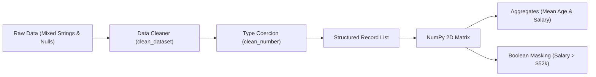

<div align="center">

# 📊 Week 1: Python Data-Processing Pipeline

[](https://colab.research.google.com/drive/19q0XB9RUrdkSReAn6FGaWbdIBFoQIQ2W)
[](https://www.python.org/)
[](https://numpy.org/)
[](#)

<p align="center">
  A robust data cleaning and numerical processing pipeline built with pure Python and NumPy to handle raw, semi-structured data with missing or corrupted fields.
</p>

</div>

---

## 📝 Overview

In machine learning and data science, raw inputs are rarely clean. This project implements an end-to-end data preparation pipeline demonstrating:
1. Safe type coercion without script termination on malformed records.
2. Graceful default imputation for missing values.
3. Fast numerical computations and vectorized filtering using **NumPy arrays**.

---

## 🧠 Pipeline Architecture



---

## 🔬 Implementation Details

### 1. Ingestion & Resilient Cleaning
The raw input simulates real-world corrupted data (e.g., `"unknown"` age, empty `""` salary, missing departments). Custom functions safely sanitize each row:
- `clean_number(value, default_value)`: Catches `ValueError` exceptions and defaults missing values safely to `0.0`.
- `clean_dataset(data)`: Strips headers, processes records, and replaces missing categorical entries with `"Unknown"`.

### 2. NumPy Vectorized Processing
Once cleaned, numerical columns (`Age`, `Salary`) are extracted into an $N \times 2$ NumPy array:
- **Mean Calculation:** Evaluates `np.mean(data_array[:, 0])` (Age) and `np.mean(data_array[:, 1])` (Salary).
- **Boolean Masking:** Vectorized row filtering to isolate high earners without slow Python `for` loops:
  ```python
  high_earners = data_array[data_array[:, 1] > 52000]
  ```

---

## 💻 Sample Output

```plaintext
Raw data loaded. Total rows: 7
✅ Data cleaned. Result:
[1, 25.0, 50000.0, 'Engineering']
[2, 30.0, 60000.0, 'Marketing']
[3, 0.0, 55000.0, 'Engineering']
[4, 40.0, 0.0, 'Sales']
[5, 35.0, 70000.0, 'Engineering']
[6, 22.0, 45000.0, 'Unknown']

NumPy Array shape: (6, 2)
Average Age: 25.3
Average Salary: $46666.67

High earners (Age, Salary):
[[3.0e+01 6.0e+04]
 [0.0e+00 5.5e+04]
 [3.5e+01 7.0e+04]]
```

---

## ⚙️ Environment Setup & Execution

### Option 1: Google Colab (One-Click)
Open the pre-configured notebook directly in Colab:  
[](https://colab.research.google.com/drive/19q0XB9RUrdkSReAn6FGaWbdIBFoQIQ2W)

### Option 2: Local Terminal

1. **Navigate to the week directory:**
   ```bash
   cd Week-1-Data-Processing
   ```

2. **Create and activate a virtual environment:**
   ```bash
   # Windows PowerShell
   python -m venv .venv
   .venv\Scripts\Activate.ps1

   # Linux / macOS
   python3 -m venv .venv
   source .venv/bin/activate
   ```

3. **Install dependencies:**
   ```bash
   pip install -r requirements.txt
   ```

4. **Run the script:**
   ```bash
   python week1_data_processing.py
   ```

---

## 📁 Folder Structure

```plaintext
Week-1-Data-Processing/
├── README.md                   # Project documentation
├── requirements.txt            # Minimal dependencies (numpy)
├── week1_data_processing.ipynb # Jupyter / Google Colab notebook
└── week1_data_processing.py    # Standalone executable script
```

---

<div align="center">
  <a href="../">⬅️ Return to Main Repository</a> • <a href="../Week-2%20Mini%20Semantic%20Search">Go to Week 2: Mini Semantic Search ➡️</a>
</div>
