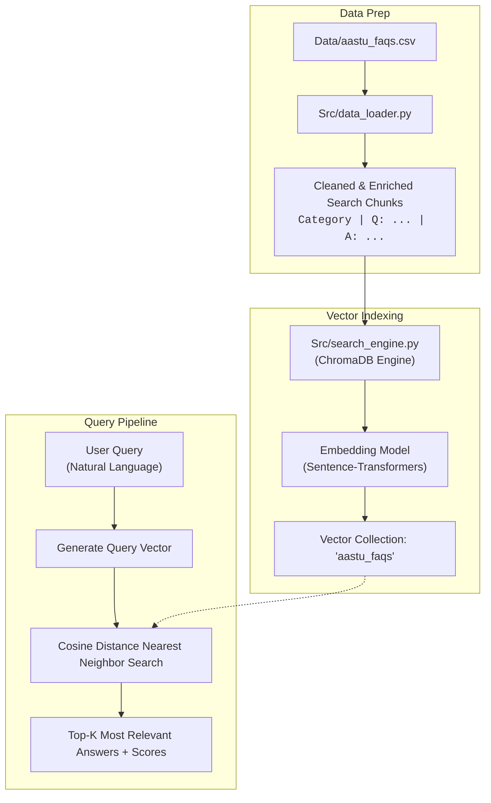

<div align="center">

# 🔍 Week 2: Mini Semantic Search Engine

[](https://colab.research.google.com/drive/1RjCP4c_69brDS6ZIWp2UwKHAXX-7hrNg)
[](https://www.python.org/)
[](https://www.trychroma.com/)
[](https://pandas.pydata.org/)
[](https://huggingface.co/sentence-transformers/all-MiniLM-L6-v2)

<p align="center">
  A modular vector search engine built on <b>ChromaDB</b> and <b>Sentence-Transformers</b> that indexes university FAQs and resolves natural language queries via semantic intent rather than keyword matching.
</p>

</div>

---

## 🎯 Overview

Traditional keyword-based search fails when a user's vocabulary differs from the reference document (e.g., searching for *"pick my courses"* when the database only mentions *"class registration"*).

This project implements a **Semantic Search Engine** over an **AASTU University FAQ dataset**:
- Converts structured FAQ entries into enriched text search chunks.
- Computes high-dimensional dense embeddings for each chunk.
- Leverages **ChromaDB** to index vectors and execute sub-second cosine distance searches.

---

## 🏗️ System Architecture



---

## 📂 Modular Structure

The codebase is engineered with separation of concerns:

```plaintext
Week-2 Mini Semantic Search/
├── Data/
│   └── aastu_faqs.csv           # FAQ knowledge base across IT, Finance, Academics, etc.
├── Src/
│   ├── data_loader.py           # Ingestion, validation, and composite chunk formatting
│   └── search_engine.py         # Encapsulated ChromaDB wrapper class for indexing & querying
├── requirements.txt             # Project dependencies (pandas, chromadb, sentence-transformers)
├── week2_semantic_search.ipynb  # Interactive Google Colab notebook
└── week2_semantic_search.py     # End-to-end execution pipeline script
```

### Core Components
- **`Src/data_loader.py`**: Reads `aastu_faqs.csv`, handles missing values, and builds context-rich search chunks formatted as:
  $$\text{Search Chunk} = \text{"Category: } C \text{ | Q: } Q \text{ | A: } A\text{"}$$
- **`Src/search_engine.py`**: Encapsulates a reusable `FAQSearchEngine` class with methods:
  - `__init__(collection_name="aastu_faqs")`: Boots in-memory ChromaDB client.
  - `index_documents(documents, ids)`: Automatically computes dense embeddings and indexes documents.
  - `search(query, top_k=3)`: Queries the vector space and returns documents sorted by semantic distance.

---

## 💡 Example Semantic Match

Notice how the system understands user intent without matching exact keywords:

```plaintext
🔍 Query: "I can't log into the student portal to pick my courses."
============================================================
Match 1 (Distance: 0.8372):
Category: Registration | Q: How do I register for my classes? | A: Log into portal.aastu.edu.et using your student ID. Navigate to the 'Registration' tab. Registration opens two weeks before the semester begins.
------------------------------------------------------------
Match 2 (Distance: 1.1568):
Category: IT Support | Q: How do I connect to the campus Wi-Fi? | A: The student Wi-Fi network is 'AASTU-Student'. Use your student ID number as the default password.
------------------------------------------------------------
Match 3 (Distance: 1.2054):
Category: Academics | Q: When do final exams take place? | A: Final exams are scheduled at the end of each semester, typically in January and June. Check the department notice boards for the exact schedule.
------------------------------------------------------------
```

---

## 🚀 How to Run

### Option 1: Google Colab (Recommended)
Open and run the notebook in your browser with zero local configuration:  
[](https://colab.research.google.com/drive/1RjCP4c_69brDS6ZIWp2UwKHAXX-7hrNg)

### Option 2: Local Setup

1. **Enter the project directory:**
   ```bash
   cd "Week-2 Mini Semantic Search"
   ```

2. **Create and activate a virtual environment:**
   ```bash
   # Windows PowerShell
   python -m venv .venv
   .venv\Scripts\Activate.ps1

   # Linux / macOS
   python3 -m venv .venv
   source .venv/bin/activate
   ```

3. **Install dependencies:**
   ```bash
   pip install -r requirements.txt
   ```

4. **Run the search pipeline:**
   ```bash
   python week2_semantic_search.py
   ```

---

## 🔮 Future Improvements

- [ ] Add vector persistence to disk (`chromadb.PersistentClient`).
- [ ] Connect with a generative LLM (Amazon Bedrock / Claude / Llama) to form a complete **Retrieval-Augmented Generation (RAG)** pipeline.
- [ ] Add a lightweight web interface with Streamlit.

---

<div align="center">
  <a href="../Week-1-Data-Processing">⬅️ Go to Week 1: Data Processing</a> • <a href="../">Return to Main Repository 🏠</a>
</div>
