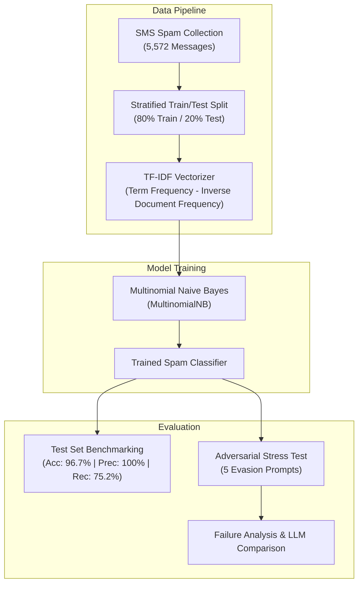

<div align="center">

# 🛡️ Week 3: Spam Detection & Classical ML Boundaries

[](https://colab.research.google.com/drive/1Bm4YgGYSUNGivXSCsnoBLKibcOw5hNht)
[](https://www.python.org/)
[](https://scikit-learn.org/)
[](https://pandas.pydata.org/)
[](#)

<p align="center">
  A comparative exploration of traditional Machine Learning (<b>TF-IDF + Multinomial Naive Bayes</b>) for text classification, probing its empirical strengths against adversarial evasion attacks, leetspeak, and syntactic context.
</p>

</div>

---

## 📝 Overview

Classical NLP classification pipelines often boast high benchmark accuracy on standard datasets. However, because they rely on word frequency statistics without contextual awareness, they remain vulnerable to simple evasion tactics.

In this project:
1. We train an end-to-end **TF-IDF + Multinomial Naive Bayes** classifier on 5,572 SMS messages.
2. We benchmark its quantitative performance (**Accuracy: 96.68%**, **Precision: 100%**, **Recall: 75.17%**).
3. We conduct an **adversarial stress test** using 5 carefully engineered test prompts to systematically expose the fundamental limitations of Bag-of-Words (BoW) architectures compared to modern Large Language Models (LLMs).

---

## 🧠 System Architecture



---

## 📊 Dataset & Baseline Performance

We utilize the [SMS Spam Collection Dataset](https://archive.ics.uci.edu/ml/datasets/sms+spam+collection) (5,572 total entries: 4,825 Ham, 747 Spam).

### Quantitative Metrics (Test Split: 1,115 samples)

| Metric | Score | Analytical Interpretation |
| :--- | :---: | :--- |
| **Accuracy** | **96.68%** | High baseline correctness across standard, in-distribution test messages. |
| **Precision (Spam)** | **100.00%** | Zero false positives in the test split — legitimate messages (`ham`) are never flagged as spam. |
| **Recall (Spam)** | **75.17%** | Significant blindspot — the model misses approximately **24.8%** of spam messages due to lexical variation. |

> [!IMPORTANT]
> The **100% precision / 75.2% recall** trade-off is characteristic of Naive Bayes text classifiers with uniform smoothing. While conservative and safe against blocking important emails, it leaves a wide attack surface for malicious actors.

---

## 🧪 Adversarial Stress Test: "Breaking the Model"

To probe beyond standard benchmark numbers, 5 adversarial inputs were tested against the trained vectorizer and classifier:

| Test Message | Actual | Model Predicted | Outcome | Vulnerability / Mechanism |
| :--- | :---: | :---: | :---: | :--- |
| `"Cl@im your fr33 g1ft card now"` | **Spam** | ❌ `ham` | **Evaded** | **Leetspeak / Spelling Trick:** Non-standard characters (`fr33`, `g1ft`) are absent from the vocabulary, dropping the spam probability to zero. |
| `"Not free, just confirming lunch at 1pm"` | **Ham** | ✅ `ham` | **Passed** | **Negation Sensitivity:** Correctly classified here, but fragile since Bag-of-Words discards word order and negation polarity (`not free` $\neq$ `free`). |
| `"Congratulations! You won a $1000 Walmart gift"` | **Spam** | ✅ `spam` | **Caught** | **Lexical Overlap:** Contains strong, high-frequency spam tokens present in the training corpus (`won`, `gift`). |
| `"Hey, are we still meeting at the library?"` | **Ham** | ✅ `ham` | **Passed** | **Standard Baseline:** Standard conversational syntax correctly mapped to high-probability ham distribution. |
| `"URGENT: Your account is locked. Click here to verify."` | **Spam** | ❌ `ham` | **Evaded** | **Out-of-Vocabulary / Phishing:** Urgency phrasing common in modern phishing (`verify`, `locked`) was unrepresented in the historical SMS dataset. |

---

## 🔬 Classical ML vs. Large Language Models (LLMs)

Why did the classical model fail, and why are modern Transformer architectures superior?

```
┌─────────────────────────────────┬─────────────────────────────────┐
│       Classical ML (TF-IDF)     │     Modern Transformers / LLMs  │
├─────────────────────────────────┼─────────────────────────────────┤
│ • Bag-of-Words representation    │ • Multi-Head Self-Attention     │
│ • Discards grammar & word order │ • Preserves sequential syntax   │
│ • Full-word exact matching      │ • Sub-word tokenization (BPE)   │
│ • Easily fooled by leetspeak    │ • Resolves "fr33" -> "free"     │
│ • Requires labeled dataset      │ • Strong zero-shot generalization│
└─────────────────────────────────┴─────────────────────────────────┘
```

1. **Sub-Word Tokenization:** LLMs utilize Byte-Pair Encoding (BPE) or WordPiece tokenizers, allowing them to segment and understand perturbed words like `fr33` and `cl@im` even if unseen in training.
2. **Context & Negation:** Self-attention mechanisms model multi-token dependencies, distinguishing `"not free"` (negation) from an advertisement offering `"free"` items.
3. **Semantic Abstraction:** LLMs identify the *pragmatic intent* of an urgent verification message as potential phishing, rather than merely scoring individual token occurrence counts.

---

## 🚀 How to Run

### Option 1: Google Colab (Recommended)
Launch the interactive notebook directly with full outputs and visualizations:  
[](https://colab.research.google.com/drive/1Bm4YgGYSUNGivXSCsnoBLKibcOw5hNht)

### Option 2: Local Python Execution

1. **Navigate to the week directory:**
   ```bash
   cd "Week-3 Spam filter"
   ```

2. **Activate your environment:**
   ```bash
   # Windows PowerShell
   python -m venv .venv
   .venv\Scripts\Activate.ps1

   # Linux / macOS
   python3 -m venv .venv
   source .venv/bin/activate
   ```

3. **Install dependencies:**
   ```bash
   pip install -r requirements.txt
   ```

4. **Execute the pipeline:**
   ```bash
   python week3_spam_filter.py
   ```

---

## 📁 Folder Structure

```plaintext
Week-3 Spam filter/
├── README.md               # Project analysis and documentation
├── requirements.txt        # Minimal dependencies (pandas, scikit-learn)
├── week3_spam_filter.ipynb # Interactive notebook with Colab outputs
└── week3_spam_filter.py    # Standalone reproducible script
```

---

<div align="center">
  <a href="../Week-2%20Mini%20Semantic%20Search">⬅️ Go to Week 2: Mini Semantic Search</a> • <a href="../">Return to Main Repository 🏠</a>
</div>
