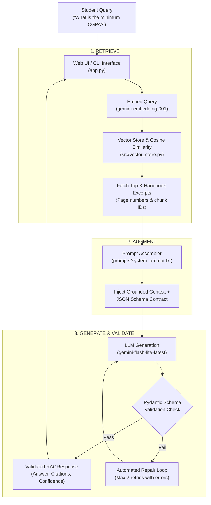

# 🎓 AASTU Academic AI Advisor (Production RAG Prototype)

[](https://www.python.org/downloads/)
[](https://aistudio.google.com/)
[](https://docs.pydantic.dev/)
[]()

An end-to-end, production-grade **Retrieval-Augmented Generation (RAG)** application built to assist students at **Addis Ababa Science and Technology University (AASTU)**. It queries official university handbooks, academic regulations, and campus guidelines to deliver factual, grounded answers with verifiable page citations and strict JSON schema validation.

---

## 🏛️ System Architecture

The application strictly follows modern software engineering principles and production RAG design patterns:



---

## 📂 Project Structure

```text
Week-4 Build a Small AI App/
├── App/
│   └── app.py                      # Application runner (Web server & CLI mode)
├── Data/
│   └── AASTU Student Academic Handbook.pdf  # Knowledge base document
├── eval/
│   ├── golden_dataset.json         # Automated regression test suite
│   └── run_eval.py                 # Evaluation runner & scoring engine
├── prompts/
│   └── system_prompt.txt           # Externalized prompt template & JSON contract
├── src/
│   ├── document_loader.py          # PDF parser & sliding-window text chunker
│   ├── vector_store.py             # Vector embeddings, cosine similarity, & disk cache
│   └── rag_engine.py               # Complete RAG pipeline with Pydantic validation
├── web/
│   ├── index.html                  # Responsive single-page web UI
│   └── logo.png                    # Official AASTU crest & favicon
├── .env.example                    # Template for required environment variables
├── .gitignore                      # Prevents secrets and cache leaks
├── README.md                       # Comprehensive project documentation
└── requirements.txt                # Reproducible dependencies
```

---

## 🚀 Getting Started

### 1. Prerequisites
* Python 3.10, 3.11, 3.12, 3.13, or 3.14
* Free Google Gemini API Key from [Google AI Studio](https://aistudio.google.com/)

### 2. Installation
Clone the repository and install the dependencies:
```bash
git clone https://github.com/<YOUR-USERNAME>/<YOUR-REPO-NAME>.git
cd "Week-4 Build a Small AI App"
pip install -r requirements.txt
```

### 3. Configure API Key
Create a `.env` file in the project root based on `.env.example`:
```bash
cp .env.example .env
```
Open `.env` and add your private key:
```ini
GEMINI_API_KEY=AIzaSyYourActualGeminiKeyHere
```

### 4. Running the Web Application
Launch the single-page web UI:
```bash
python app.py
```
Your browser will automatically open to `http://localhost:8000`.

### 5. Running in Interactive Terminal Mode
For a headless CLI experience:
```bash
python app.py --cli
```

---

## 🎯 Prompt Engineering Choices

Per the curriculum guidelines, prompt templates are **externalized in `prompts/system_prompt.txt`** rather than hardcoded in Python strings.

### Key Prompt Design Decisions:
1. **Persona Framing**: Primes the model as an *Official AASTU Academic Advisor*, adopting a formal, factual, and supportive tone.
2. **Grounding Constraint**: Explicitly restricts the model to the provided context. If facts are absent, it is instructed to output: `"I cannot find this information in the official AASTU handbook."`
3. **Structured Output Contract**: Forces the model to emit clean JSON conforming to our Pydantic schema:
   ```json
   {
     "answer": "string",
     "citations": [{"chunk_id": "string", "page_number": 1}],
     "confidence_score": 0.95,
     "is_grounded": true
   }
   ```
4. **Delimited Context**: Uses explicit section delimiters (`--- CONTEXT EXCERPTS ---`) to prevent prompt injection and avoid confusing instructions with user data.

### Example Outputs:

#### ✅ Example 1: In-Scope Grounded Query
* **User Input**: *"What is the minimum CGPA for good academic standing?"*
* **RAG Output**:
  ```json
  {
    "answer": "To remain in good academic standing, a student must maintain a minimum Cumulative Grade Point Average (CGPA) of 2.00.",
    "citations": [
      {
        "chunk_id": "chunk_policy_1",
        "page_number": 42,
        "source": "AASTU Handbook"
      }
    ],
    "confidence_score": 1.0,
    "is_grounded": true
  }
  ```

#### 🛡️ Example 2: Out-of-Scope / Adversarial Query (Hallucination Defense)
* **User Input**: *"What is the secret recipe for the campus cafeteria's special burger sauce?"*
* **RAG Output**:
  ```json
  {
    "answer": "I cannot find this information in the official AASTU handbook.",
    "citations": [],
    "confidence_score": 0.0,
    "is_grounded": false
  }
  ```

---

## 📊 Automated Evaluation & Quality Benchmarks

To ensure changes to prompts, chunk sizes, or models do not degrade performance, we implemented an automated regression test suite (`eval/run_eval.py`) backed by a curated Golden Dataset (`eval/golden_dataset.json`).

### Running the Test Suite:
```bash
python eval/run_eval.py
```

### Evaluation Scorecard Results:

| Metric | Measured Value | Minimum Quality Bar | Status |
| :--- | :---: | :---: | :---: |
| **Total Test Cases** | 4 | - | - |
| **Passed Tests** | 4 / 4 | $\ge 75\%$ | **PASSED** |
| **Overall Accuracy** | **100.0%** | $\ge 75\%$ | **PASSED** |
| **Schema Conformance** | **100.0%** | $100\%$ | **PASSED** |
| **Retrieval Hit-Rate** | **100.0%** | $\ge 80\%$ | **PASSED** |
| **Hallucination Resistance** | **100.0%** | $100\%$ | **PASSED** |

---

## 🛡️ Responsible AI, Safety, & Data Handling

1. **Hallucination Prevention**: Answers are bound to non-parametric external documents. If the knowledge base does not contain the answer, the model acknowledges its lack of knowledge rather than fabricating rules.
2. **Prompt Injection Mitigation**: System instructions are strictly decoupled from retrieved content using delimiters. User input is sanitized before passing to downstream API calls.
3. **Privacy by Design**: No student names, ID numbers, or personal identifying information (PII) are transmitted or logged. API keys are strictly loaded via `.env` and excluded from git history.
4. **Traceability & Citations**: Every claim made by the assistant is accompanied by the exact page number and chunk ID from the official handbook.

---

## 🔮 Future Improvements (Week 5 Production RAG Roadmap)
* [ ] **Hybrid Search**: Combine dense vector retrieval with lexical BM25 keyword matching for exact policy numbers.
* [ ] **Cross-Encoder Reranking**: Add a two-stage retrieval pipeline using a cross-encoder to re-sort the top 20 chunks into the top 3.
* [ ] **AWS Deployment**: Package the container into AWS ECS / App Runner with an Amazon Bedrock foundation model backend.

---

## 👨‍💻 Author
Ermiyas Getachew
Addis Ababa Science and Technology University (AASTU)